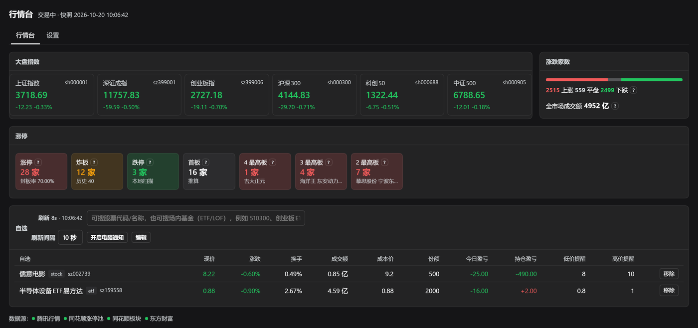
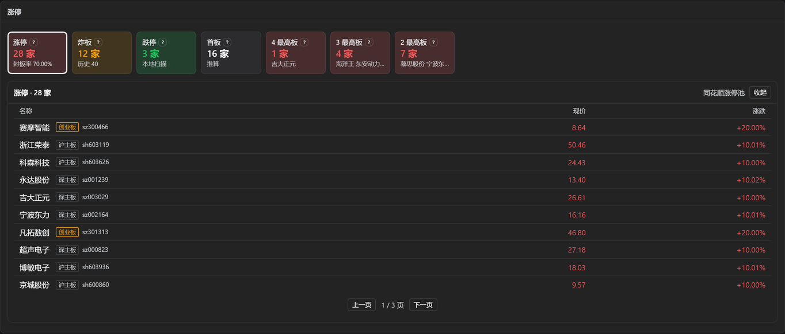
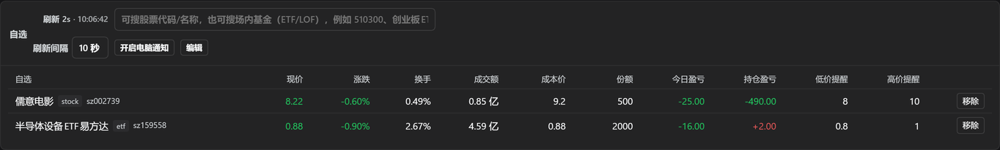
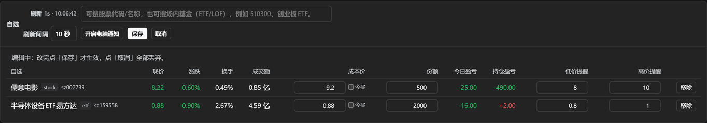
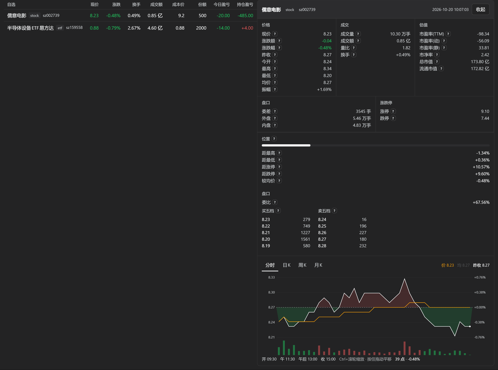
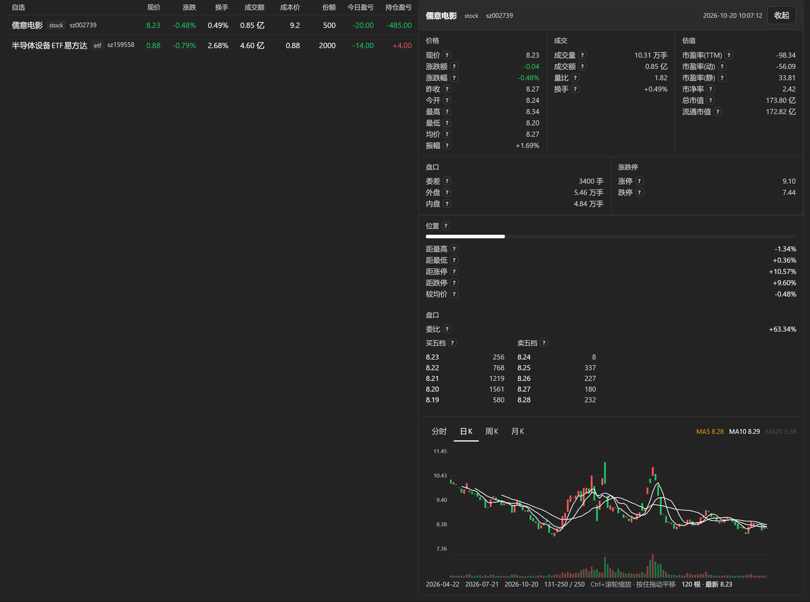
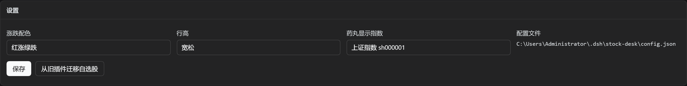

# dsh-stock-desk

面向 DSH 的 A 股行情工作台插件。在 Web UI 侧边栏提供一个整页行情台，
在对话页右下角常驻一个药丸，并向 agent 注册 7 个行情取数工具。

界面与 agent 读同一份自选数据，不存在「界面改了、agent 还看旧值」这类两套状态问题。

> **本项目只做行情数据的获取、汇总与历史统计**：不提供投资建议，不做选股推荐，
> 不预测价格走势与点位。数据来自第三方公开网页接口，可能延迟、缺失或随时失效。
> 据此做出的任何决策及其后果由使用者自行承担。详见[免责声明](#免责声明)。

## 目录

- [功能](#功能)
- [安装](#安装)
- [外部数据源](#外部数据源)
- [配置](#配置)
- [已知边界](#已知边界)
- [开发](#开发)
- [测试](#测试)
- [项目结构](#项目结构)
- [免责声明](#免责声明)
- [许可证](#许可证)

## 功能

### 盘面总览

第一行横向排布，覆盖当日最主要的市场状态：

| 内容 | 说明 |
|---|---|
| 6 个指数 | 上证指数、深证成指、创业板指、沪深 300、科创 50、中证 500；点位与涨跌幅实时刷新，点击可查看该指数的 K 线与分时 |
| 涨跌家数 | 全市场上涨 / 下跌 / 平盘家数 |
| 全市场成交额 | 与涨跌家数来自同一次全市场扫描，因此两个数字属于同一时点，不会出现「家数是 10:00、成交额是 10:03」 |



顶部一行是标题与「交易中 · 快照 10:06:42」，快照时间是这轮取数的实际时刻，
不是渲染时刻 —— 数据停了，时间也会停。

### 涨停与连板

涨停、炸板、跌停、连板梯队、首板五项全部以格子呈现，每格可点击下钻：

- **下钻明细**按涨跌幅排序，分页展示，每页 10 条
- 明细里的股票带板块标识（主板 / 创业板 / 科创板），便于判断是否在自身交易权限内
- 每个字段旁有问号图标，鼠标悬停给出该指标的定义（如「炸板」「首板 = 涨停家数 − 连板家数」）



连板梯队的每一档（`4 最高板`、`3 最高板`…）也是一个格子，点下去看这一档的具体个股。

### 板块

同花顺行业板块，两个维度、各取 10 个：

- **涨最狠 10 个**
- **跌最狠 10 个**

格子可点击下钻到该板块的成分股，同样按涨跌幅排序、每页 10 条。

### 自选、持仓与监控

自选表把**持仓**与**价格监控**整合在同一行，因为它们本来都是「某只自选股」的属性：

| 列 | 说明 |
|---|---|
| 持有 | 纯标记，勾上后该行显示「持」；不参与盈亏计算 |
| 成本价 | 手工填写 |
| 份额 | 手工填写 |
| 今买 | 勾选后，今日盈亏以你的成本价作基准，而非昨收 |
| 今日盈亏 | 未勾选「今买」时按昨收计算 |
| 持仓盈亏 | 按成本价计算 |
| 价格提醒 | 上限与下限两个阈值 |

编辑入口在**每一行的末尾**，点谁编谁：只有这一行的格子变成输入框，「保存 / 取消」也只作用于这一行，
其他行照常显示行情。保存才生效，取消全部丢弃 —— 避免误触直接改动持仓数据。

### 所属板块

股票名后面用小字标出**所属板块**（行业，如「乘用车」「影视院线」），鼠标停上去显示地域与全部概念：

```
儒意电影  影视院线   sz002739
         ↑ 行业        ↑ 地域：北京板块
                        概念：网络游戏、影视概念、抖音概念(字节概念)…
```

- 数据来自东财 `ulist` 批量接口，**整张表一次请求**（本地实测 86 ms，之后 6 小时走缓存 2 ms）。
- ETF 没有行业归属，那一行就不标，不占位也不编一个「基金」出来。
- 取不到就只是不标板块：行情、盈亏、均价全部照常，不会因为东财挂了整页变空。
- 行业分类口径是东财的（「乘用车」），与板块卡里同花顺的板块名（「汽车整车」）不一定同名 ——
  两套分类体系，不要拿它们互相对账。

超过 10 只时分页，一页 10 条，卡片底部给页码和「上一页 / 下一页」。编辑某一行的期间，
页码会钉在这一行所在的那一页并禁用翻页按钮 —— 否则改到一半点一下表头，那一行被排到别页，
「保存 / 取消」跟着消失，填好的数字就白填了。

点表头排序：名称 / 持有 / 现价 / 涨跌 / 日均价 / 周均价 / 月均价 / 成本价 / 份额 / 今日盈亏 / 持仓盈亏。
**默认按「持有」排序**，持有的在前；未持有的行之间保持自选顺序（排序是稳定的），
所以没勾过「持有」时看到的仍是原来的次序。
同一列再点一次换方向（▲▼）。名称列第一次点按升序，数字列按降序；**没数据的行永远排最后**，
不随方向翻面 —— 否则按涨跌排序时，「没填成本价」的那些会挤在涨得最多的前面。
价格提醒两列不参与排序。

**三条均价的口径**（鼠标停在这三个格子上会显示同样的说明）：

| 列 | 算法 | 数据源 |
|---|---|---|
| 日均价 | 今天的成交额 ÷ 成交量 | 腾讯实时报价直接给，精确值 |
| 周均价 | 本周（周一起，含今天）各交易日**收盘价按成交量加权** | 腾讯日 K，每 60 秒重算 |
| 月均价 | 本月（1 号起，含今天）同上周均价 | 腾讯日 K，每 60 秒重算 |

它们**不等于**日线 / 周线 / 月线：K 线一根只有开高低收和成交量，没有「均价」这一项。
腾讯日 K 也不给逐日成交额，所以做不出真正的成交额加权 VWAP，周/月只能用
`Σ(收盘价 × 成交量) ÷ Σ(成交量)`；成交量加权已经能压住「缩量涨停那天把均值拉高」。
交易日按自然周（周一）/自然月切，周期锚在最新那根日 K 上而不是本机时钟上，
否则周一早上拿到的是上周五的数据，「本周」会算成空区间。取不到时显示「—」，不写 0。

自选支持搜索添加，股票与场内基金均可；也支持**从截图认出股票**，见下一节。





### 图片解析股票

自选卡头的搜索框右边有一个「图片解析股票」按钮：把券商的自选或持仓截图贴进去（`Ctrl+V` / 拖拽 / 选文件都行），
插件认出里面的股票，列成候选，勾选后一次加入自选 —— 不用再一个代码一个代码地敲。

候选行上有两个勾选框，管的是两件不同的事：

| 勾选框 | 作用 |
|---|---|
| 左侧 | 这只**要不要加进自选**，默认全勾 |
| 右侧「持有」 | 加进去的同时**标成持有**，默认不勾 |

持仓截图里基本全是已持有的，所以右边这一列省掉的是「加进自选后再回表格逐行勾持有」。
取消左侧勾选会连右边的持有标记一起撤掉 —— 一只没加进来的股票不该被标成持有。
持有标记只写 `held`，不会碰你已经填好的成本价与份额。

识别在本机完成，走 Windows 自带的 OCR（`Windows.Media.Ocr`），不联网、不上传图片。
匹配以**股票名**为主、代码为辅：实测中文名基本全对，而数字会被错认（`600519` 认成 `600S19`），
所以代码要先按错认表还原，再落进内置代码池（5575 只股票 + 1707 只场内基金）才算命中。
候选上会标出这一行是「按代码命中」还是「按名称命中」，方便你复核。

已知的识别边界：

- 需要系统装有**中文（简体）OCR 语言包**。没装时面板会直接说明，不会让你贴完图才发现。
- 只认 PNG / JPEG / BMP / GIF。WebP 请另存后再贴。
- 券商只显示简称时可能对不上全名，这类情况宁可不出候选，也不猜。
- 2 字股票名不参与包含匹配（像「中信」这种片段在任何长文本里都会命中，会把候选刷满）。
- 识别错了的代价只是多一条候选或少一条，不会被自动写进自选 —— 加不加由你勾。

### 个股详情

点击任意一只股票（自选、板块成分股、涨停名单、指数）都会在**右侧栏**打开详情，
不需要把页面滚到底部。详情默认展示分时图，可切换到日 / 周 / 月 K 线与分钟线，支持缩放与平移。





分时的纵轴以昨收为中心上下对称取幅度，K 线才用绝对价格 —— 前者看当天强弱，后者看趋势。

### 常驻药丸

对话页右下角常驻一个药丸：所选指数的点位与涨跌幅、自选里涨跌各几只。
点开行情台看全貌，日常扫一眼不必离开对话。药丸可以拖到任意位置，位置记在本机浏览器上，
换台机器不跟着走；`×` 关掉后不再出现。

**点一下展开成一个小操作栏**，不用跳进行情台就能看到持仓的当日成绩：

```
        ┌──────────────────────────────────────────────┐
        │  ‹       上证指数 3734.33  +0.49%          › │  ← 左右滑动 / ‹ › / ← →
        │  名称              现价     涨跌    今日盈亏 │  ← 列名
        │  儒意电影          8.28   +0.12%      +2.00 │
        │  半导体设备ETF易方达 0.877  -1.35%     -12.00 │
        │  领益智造         10.99   +4.97%     +52.00 │
        │  持有 3 只                     合计 +42.00 │
        │                       左右滑动换指数 · 点药丸收起 │
        └──────────────────────────────────────────────┘
        上证指数 3734.33 +0.49%  ↑6 ↓3   ×     ← 药丸本体
```

- **列名**：名称 / 现价 / 涨跌 / 今日盈亏，与自选表表头是同一套文案。
  不标的话最右边那个数容易被当成涨跌额或市值。
- **列哪些票**：自选表里勾了「持有」的那些。勾了持有但不在自选里的票没有行情可取，
  底部会写「N 只不在自选，未计入」，不让合计看起来像少算了。
- **当日盈亏**：按昨收算（勾了「今买」的按成本价算），与自选表那一列同一套算法。
- **换指数**：在面板头部左右滑动，或点 ‹ ›，或按 ← →。两头循环，选完写进配置
  （`pill.indexCode`），下次打开还是它 —— 设置页里那个下拉框选的是同一项。
- **收起**：再点一下药丸、点面板外面、或按 Esc。长按拖动改位置这一招没变，
  拖动结束不会顺带弹面板。
- 面板往上弹还是往下弹、靠左还是靠右，取决于药丸被拖到屏幕的哪个角落。


### 刷新与监控

- 默认每 10 秒自动刷新，刷新间隔可配置
- 卡片上有一个倒计时与上次取数时间，用来判断数据是否还在更新
- 价格监控设上下两个阈值，**只在价格跨过阈值的那一刻**发送桌面通知，不会反复提醒

### agent 工具

| 工具 | 用途 |
|---|---|
| `stock_quote` | 个股 / 指数 / ETF 实时报价，含五档盘口 |
| `market_overview` | 大盘与市场情绪总览：指数、涨跌家数、涨停跌停家数、封板率 |
| `limit_up_board` | 涨停与连板梯队、炸板池明细、板块涨停分布 |
| `sector_rank` | 板块涨跌幅排行，含主力净流入与领涨股 |
| `stock_kline` | 个股 / 指数 / ETF 的 K 线、区间统计与技术指标（均线 / ATR / 量比 / 区间位置） |
| `stock_analysis` | 单只股票的事实表：技术指标、历史形态频率（含基准与 95% 区间）、位置表、四条判定与参考位 |
| `stock_watchlist` | 读取用户自选分组 |

工具定义全部注册，但模型只在真正需要时才读取其 schema；7 个定义合计约 1.5 KB。
`stock_watchlist` 读的就是界面上那份自选，两边不会不一致。

### 界面偏好

设置页可调整涨跌配色（红涨绿跌 / 绿涨红跌，或跟随主题）、表格行高（宽松 / 紧凑），
以及药丸上显示哪一个指数。



## 安装

### 从 npm

当前版本 **2026.10.20**（首个正式版）。最新版本见
[npm](https://www.npmjs.com/package/dsh-stock-desk) 或
[Releases](https://github.com/shan1110/dsh-stock-desk/releases)。

```powershell
plugin_manager(action: install_bundle, target: "dsh-stock-desk@2026.10.20")
```

或使用 CLI：

```bash
dsh plugin --profile <你的 profile> add dsh-stock-desk@2026.10.20
```

装完刷新浏览器页面，侧边栏出现行情台图标。

### 从源码

```powershell
git clone https://github.com/shan1110/dsh-stock-desk.git
cd dsh-stock-desk
node tools/check-resolution.mjs      # 先确认 @deepseek-ai/* 能解析，否则装了也不会激活
dsh plugin --profile <你的 profile> install .
```

`check-resolution.mjs` 不能跳过。装载器对路径解析失败的报错写在 warning 里，
表现为「安装成功但 fiber 不 active」。原理见 [安装与激活实测](docs/安装与激活实测.md)。

### 环境要求

| 项 | 要求 |
|---|---|
| Node.js | >= 24 |
| DSH | 在 0.2.1-rc.2 上验证 |
| 平台 | Web UI（`dsh.client.platform` 为 `web`） |

## 外部数据源

插件运行时由**本机**直接请求下列公开行情接口，不经过任何中转服务器，不含遥测。

| 域名 | 用途 |
|---|---|
| `qt.gtimg.cn` | 腾讯行情：实时报价、五档盘口、日 / 周 / 月 K 线、分时 |
| `data.10jqka.com.cn`、`basic.10jqka.com.cn` | 同花顺：涨停池、连板梯队、炸板池、行业板块榜与成分股 |
| `push2his.eastmoney.com`、`push2.eastmoney.com` | 东方财富：分钟线 K 线兜底、板块涨跌幅、个股所属板块（行业 / 地域 / 概念） |

这些是各站点网页自身使用的公开接口，不需要账号或 token。**它们不是官方 API**，
可能随时改变结构、限流或失效。插件对这类失败的处理方式是降级并显式标注数据来源，
不会用陈旧数据冒充实时数据。

## 配置

配置落在 `~/.dsh/stock-desk/config.json`，纯本地文件，不上传。

| 字段 | 说明 |
|---|---|
| `groups` | 自选分组与分组内的代码 |
| `positions` | 每只股票的成本价、份额、今买标记 |
| `alerts` | 每只股票的价格提醒上下限 |
| `ui.pollSec` | 自动刷新间隔（秒），默认 10 |
| `ui.colorScheme` | 涨跌配色：`auto` / `redUp` / `greenUp` |
| `ui.density` | 表格行高：`comfortable` / `compact` |
| `pill.indexCode` | 药丸显示的指数代码（药丸上左右滑动换的也是它） |
| `pill.enabled` | 是否显示药丸（`false` 等同于点药丸上的 `×`） |

宿主进程读不到 `DSH_PROFILE_DIR` / `DSH_PROFILE`（这两个变量只注入给子进程），
Host 也没有服务提供 profile 目录，因此配置走 DSH 家目录这条兜底路径 ——
好处是换 profile 不会丢自选。当前命中的规则可由 `store.info().rule` 读出。

## 已知边界

- **市场范围**：仅 A 股主板、创业板、科创板。港股与美股不支持（腾讯港股只有 78 个字段且与 A 股错位）；
  北交所代码不在代码池内，请求会被拒绝。
- **概念板块无涨跌幅数据**：板块格子只覆盖同花顺行业板块（约 90 个）。腾讯虽有板块榜，
  但与同花顺名称重合率仅约 31%，无法用于下钻，故未采用。
- **板块成分股免费页数有限**：同花顺匿名接口只开放前 5 页成分股。超出部分接口会返回
  `truncated` 标记，界面照实提示，不静默截断。
- **无基本面数据**：不含财务、新闻、公告。
- **数据源限流是真实的**：连续高频请求会被临时拒绝，插件按 30 秒起步、上限 600 秒做递增冷却。
- **收盘后不刷新行情**：界面显示「已收盘」与快照时间，不拿陈旧数据顶替。
- **开盘前部分接口返回空**：集合竞价期间同花顺的涨停池与板块接口会报错，此时对应卡片留空并标注原因。

## 开发

改动代码后需要重启插件 —— HMR 不会热更已激活插件的文件改动：

```
plugin_manager(set_plugin, target: "include:stock-desk", enabled: false)
plugin_manager(set_plugin, target: "include:stock-desk", enabled: true)
```

改动客户端代码还需**刷新浏览器页面**：客户端模块只在页面加载时取一次。

装完先确认客户端半边已进入启动图，再去刷新页面：

```powershell
(Invoke-RestMethod http://127.0.0.1:8820/api/stock-desk/diag).data
```

`wired: true` 表示刷新一定有效；`wired: false` 表示刷新多少次都没用，问题在 `package.json`
的 `dsh.client` 声明。两种情况排查方向完全不同。

开发期的约定与踩过的坑见 [开发与自检](docs/开发与自检.md)。

## 测试

```powershell
foreach ($t in @("test-tencent","test-sources","test-boards","test-market","test-tools","test-client","test-ocr")) {
  node "tools\$t.mjs"
}
node "tools\test-contract.mjs"    # 需要 GUI 在 http://127.0.0.1:8820 运行
```

全部套件应退出码 0。`test-contract.mjs` 直接请求运行中的 HTTP 路由，逐个核对客户端读取的字段路径。
`test-ocr.mjs` 的纯函数部分在任何机器上都必须过；真实识别那段依赖本机中文 OCR 语言包，
没装时打印 `SKIP` 而不是 `FAIL` —— 换台机器就红一遍的自检，很快就不会有人看它了。

断言的具体约定与被测行为见 [开发与自检](docs/开发与自检.md)。

## 项目结构

```
index.js             宿主入口：inject webServer + tools，建立 cache / store / market 单例
cordis.patch.yml     把插件插入 profile 的 Cordis 组合
client.js            浏览器半边：整页 + 侧边栏按钮 + 药丸。无构建步骤，故使用 React.createElement
locale/{zh,en}.json  插件管理页里的展示元数据（与 client.js 内的界面词条是两回事）

lib/tencent.js       腾讯行情：字段解析、五档盘口、涨跌停判定
lib/ths.js           同花顺：涨停池、连板梯队、炸板池
lib/boards.js        同花顺行业板块榜与成分股
lib/eastmoney.js     东方财富：分钟线 K 线兜底
lib/market.js        多源编排、TTL 缓存、降级与源健康度
lib/routes.js        HTTP 接口，统一返回 { ok, data }
lib/store.js         自选、持仓与界面配置的读写
lib/tools.js         7 个 agent 工具（defineTool）
lib/universe.js      全市场代码池（data/universe.json，5575 只股票 + 1707 只基金）
lib/ocr.js           图片识别：调 Windows 自带 OCR，再把文本对到代码池上
lib/cache.js         请求缓存、数据源健康度、递增冷却
lib/session.js       交易时段判定（竞价 / 交易中 / 午休 / 已收盘）
lib/format.js        数字格式化与数据来源标注

data/universe.json   全市场代码池，由 tools/build-universe.mjs 生成
docs/                实测记录与设计留档
tools/               探针、构建脚本、自检套件
```

### HTTP 接口

全部返回 `{ ok, data }` 信封：

```
GET  /api/stock-desk/{state,dashboard,quote,board,pool,kline,minute,avg,sectors,search,diag,ocr}
POST /api/stock-desk/{config,migrate,ocr}
```

`POST /ocr` 的请求体是 `{ "image": "data:image/png;base64,..." }`，上限 8 MB（其余接口是 256 KB）；
`GET /ocr` 只回答「这台机器能不能做中文 OCR」。只做识别与匹配，不落盘、不改配置 ——
写自选仍然走 `POST /config`。

## 文档

| 文档 | 内容 |
|---|---|
| [安装与激活实测](docs/安装与激活实测.md) | 装载器行为、激活条件、槽位注册约定 |
| [数据源实测](docs/数据源实测.md) | 各接口的限流、超时、降级实测记录 |
| [腾讯字段实测表](docs/腾讯字段实测表.md) | 88 个字段的偏移、单位与含义 |
| [东财不可达取证与板块可行性](docs/东财不可达取证与板块可行性.md) | 为什么板块走同花顺 |
| [插件市场调研](docs/插件市场调研.md) | DSH 插件市场机制与发布流程 |

## 免责声明

- 本插件只做行情数据的**获取、汇总与历史统计**：不提供投资建议，不做选股推荐，
  不预测价格走势与点位，不对任何标的给出买卖时机。
- 数据来自第三方公开网页接口（见[外部数据源](#外部数据源)），不是官方 API：可能延迟、缺失、
  字段错位或随时失效。插件会标注数据来源与降级状态，但**不保证数据准确、完整或及时**。
- 表里的盈亏与均价，只按你填写的成本价、份额和当日行情做四则运算，属于**估算**，
  不构成持仓核对依据 —— 以券商对账单为准。
- 图片解析股票靠 OCR 认代码与名称，**识别结果可能错**，保存前请自己核对。
- 据此做出的任何决策及其后果，由使用者自行承担。作者不承担任何责任。
- 本项目以 MIT 许可证开源（见[许可证](#许可证)），不提供在线托管服务、不做收费解锁。
  若要对外提供、收费或再分发，请自行确认是否触及所在司法辖区对证券投资咨询业务的资质要求 ——
  那属于使用者的责任。

## 许可证

[MIT](LICENSE)
